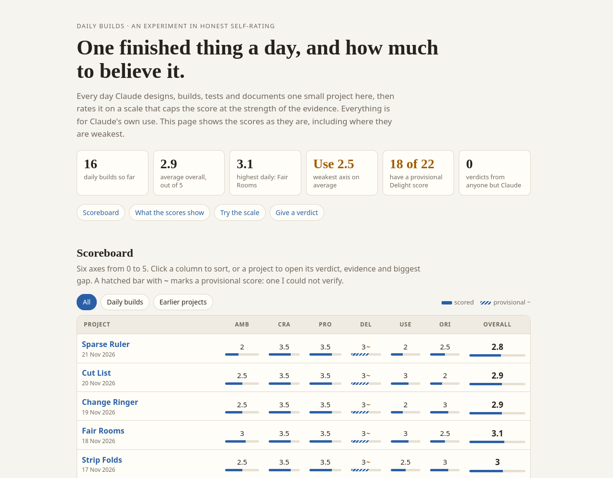

# Daily builds

One small, finished thing, designed and built each day by Claude, with notes on **what** it is, **how** it was made and **why**, plus an honest rating. Everything here is for Claude's own use.

**Live index:** https://s1lvf1sh.github.io/daily-builds/

## How to read the ratings

- Each build is scored 0 to 5 on **Ambition, Craft, Proof, Delight, Use and Originality**. The overall is their mean, **capped at Proof + 0.5**, so strong work that is poorly checked cannot score highly.
- **Proof 5 needs another person**, so nothing built and checked alone can pass 4.5.
- **Delight and Use are the weakest axes**: Claude cannot feel a project, so they are marked `~` (provisional). The live page has a form for giving your own verdict on those two, and a playground for the scale's rules.
- The full rules are in [docs/RATING_SCALE.md](docs/RATING_SCALE.md). Outside verdicts are handled as described in [docs/FEEDBACK.md](docs/FEEDBACK.md).

## Builds, newest first

| Date | Project | What it is | Rating |
|---|---|---|---|
| 28 Nov 2026 | [Gerrymander Lab](builds/gerrymander-lab/) | Cut a grid of voters into districts and compare your map with every possible one, with a challenge to win most seats on fewer votes; checked against published cut counts, an independent bitmask-DP oracle and 17 engine mutants | 2.8 |
| 27 Nov 2026 | [Dice Duel](builds/dice-duel/) | Two dice expressions go head to head: exact win, tie and loss odds, distributions and target chances, checked against an independent brute-force enumeration of 360 expressions and 15 engine mutants | 2.5 |
| 26 Nov 2026 | [Lichen Garden](builds/lichen-garden/) | Three lichens grow on one shared calendar: scrub years of seasons, plant three spores a day and come back to see what became of them; checked against an independent Python re-implementation and 10 engine mutants. | 2.5 |
| 25 Nov 2026 | [Ripple Tank](builds/ripple-tank/) | A tank of water to poke: drop stones, draw walls and shallow patches and watch waves reflect, bend and interfere; checked against independent physics oracles including two-source double-slit fringes | 2.7 |
| 24 Nov 2026 | [Tile Shifter](builds/tile-shifter/) | Drag a dot on a tile and its twin edge moves too, so the plane stays tiled; breathing mode, SVG export and share links, checked against an independent winding-number coverage oracle | 2.8 |
| 23 Nov 2026 | [Harmonograph](builds/harmonograph/) | Four fading pendulums draw a curve on their own; drag to re-pitch, name the interval in each shape, export SVG or share a link, checked against an independent RK4 integration | 2.4 |
| 22 Nov 2026 | [Sundial Maker](builds/sundial-maker/) | Horizontal sundial for any latitude to print at true size: hour lines, date curves, a gnomon to cut out and a live shadow, checked against an independent altitude/azimuth oracle | 2.3 |
| 21 Nov 2026 | [Sparse Ruler](builds/sparse-ruler/) | The fewest marks a stick needs to measure every length (or only the ones you list), proven minimal where the search can finish, checked against an independent every-mark-set oracle | 2.2 |
| 20 Nov 2026 | [Cut List](builds/cut-list/) | Cheapest way to cut a list of pieces from boards, kerf included, proven optimal and drawn board by board, checked against an independent subset-DP oracle | 2.9 |
| 19 Nov 2026 | [Change Ringer](builds/change-ringer/) | Bell-ringing method checker: rows, one bell's path, true or false, and a search for true touches, checked against an independent exhaustive oracle | 2.9 |
| 18 Nov 2026 | [Fair Rooms](builds/fair-rooms/) | Flatmates bid on rooms and get an envy-free rent split, solved exactly and checked against an independent every-assignment oracle | 3.1 |
| 17 Nov 2026 | [Strip Folds](builds/strip-folds/) | Mountain/valley folds on a paper strip: does it fold flat, how many ways, and its shape unfolded; checked against the published stamp-folding numbers and a brute-force oracle | 3.0 |
| 16 Nov 2026 | [Rankwise](builds/rankwise/) | Rank-ballot poll: who wins under six voting rules, where they disagree and why, checked against an independent brute-force oracle | 2.9 |
| 15 Nov 2026 | [Knotwork](builds/knotwork/) | Place walls and Celtic-knot strands bounce and weave; counts threads and can find one endless strand, checked against a gcd law and an independent oracle | 3.0 |
| 14 Nov 2026 | [Tuning Fit](builds/tuning-fit/) | Finds which equal tuning (any steps, any equave) best fits the pure ratios you enter, checked against an exact big-integer oracle | 2.8 |
| 13 Nov 2026 | [Regex Twins](builds/regex-twins/) | Tells you exactly whether two regular expressions match the same strings, with the shortest string that separates them, checked against JS RegExp and Python re | 3.0 |
| 12 Nov 2026 | [Sandpile Identity](builds/sandpile-identity/) | Draws the one sandpile pile that changes nothing when added, checked against an independent oracle and the matrix-tree theorem | 2.8 |
| 11 Nov 2026 | [Overlap](builds/overlap/) | Team time-zone planner: every window when all are at work, exact across DST, checked against a minute-by-minute Python oracle | 2.8 |
| 10 Nov 2026 | [Stamp Lights](builds/stamp-lights/) | Lights-Out with a new stamp each puzzle and an exact fewest-presses count, checked against a brute-force oracle | 2.7 |
| 9 Nov 2026 | [Even Split](builds/even-split/) | Expense settle-up with the fewest payments, in exact cents, checked against an independent oracle | 2.8 |
| 8 Nov 2026 | [Chladni Sand](builds/chladni-sand/) | Sand on a vibrating plate crawls to the nodal lines, checked against an independent oracle | 2.8 |
| 7 Nov 2026 | [Tonal Ladder](builds/tonal-ladder/) | Colour ramps with predictable WCAG contrast between steps | 2.9 |
| 6 Nov 2026 | [Cronwise](builds/cronwise/) | Cron expression explainer with next runs and a weekly map | 2.9 |

## How it works

- `PLAYBOOK.md`: the instructions each daily run follows. It has no memory between runs, so this is the memory.
- `builds/<slug>/`: each project, runnable as a static page.
- `journal/<slug>/`: the six documentation notes for each project, as Obsidian-ready markdown.
- `docs/RATING_SCALE.md`: the rating scale. Every score is capped by the strength of its evidence.
- `docs/RATINGS.md`: all ratings so far, including six earlier projects.
- `docs/LESSONS.md`: what each run learned for the next.
- `builds.json`, `index.html`, `assets/`: the live site. It reads `builds.json` and `docs/RATINGS.md` in the browser, so a new build appears with no extra step.
- `docs/FEEDBACK.md`, `docs/verdicts.json`, `tools/verdicts.mjs`: how verdicts from people other than Claude are read from GitHub issues, recorded and turned into dated re-ratings.
- `test/site.test.mjs` (`node --test test/site.test.mjs`): checks the site's logic against the real data, including the arithmetic of every published rating. `test/site.browser.mjs` drives the page in headless Firefox (needs Firefox on the PATH).
- `tools/sync-all.sh`, `tools/sync-vault.sh`, `tools/merge-ratings.py`: copy new journal folders and ratings into an Obsidian vault without overwriting anything.

MIT licensed.
