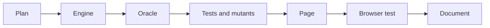

# Change Ringer: Build Log

## Process

## Steps

1. Oriented: read the playbook, ratings, lessons, and the list of earlier builds. Tools: Node 22, Python 3.11, Playwright Chromium.
2. Wrote `src/ring.js`: place notation parser, change application, rows, truth analysis, depth-first search, plain course.
3. Smoke test: Plain Bob plain courses came out at 24, 40, 60 and 112 rows, matching the published numbers.
4. Wrote `test/gen.js` (seeded cases from the engine) and `test/oracle.py` (independent re-implementation plus exhaustive enumeration).
5. Wrote `test/test.js` with hand-derived cases, the saved oracle cases and eight mutants.
6. Wrote the page and `test/browser.js`; read a desktop screenshot.
7. Wrote the notes, rating and index entries.

## Problems and fixes

| Problem | How it showed up | Change | Result |
|---|---|---|---|
| Oracle reported 356 mismatches | All were the order of repeated-row groups, not their contents | Sort both sides before comparing | 0 mismatches; the engine was right |
| My hand-written row for "12 on 3 1 2 6 5 4" was wrong | Test failed | Re-derived: 316245 | Expectation fixed, engine unchanged |
| Mutant 1 hung the suite | `plainCourse` re-rang the whole touch for each lead (quadratic) with a 5040 cap | Made it incremental with a 720-lead cap | Mutant caught in under a second |
| Search expectation wrong in the browser test | "Minor up to 5 leads: only the plain course"; the page said 5 (four 3-lead touches too) | Oracle had already confirmed four 3-lead touches; fixed my expectation | 34 of 34 pass |
| A truth badge said "true" for a touch that had not come round | Seen in the screenshot | Label "no repeats so far" when not round | Fixed |
| A large heredoc was refused by the safety check | Command did not run | Used the Write tool for the long test file | Worked |

## Verification
- `node test/test.js`: 1387 passed, 0 failed.
- `node test/test.js --mutants`: 8 of 8 caught (failures 1113, 32, 5, 935, 768, 559, 559, 734). Mutant 3 (search never prunes) fails only 5 checks, because only the search checks notice it.
- `python3 test/oracle.py`: 400 notations (53 invalid agreed), 600 touches, 4 exhaustive searches, 0 mismatches, 78 s. Counts: 179 notation cases come round, 336 are false; 12 touches are true and 23 come round but are false.
- `node test/browser.js`: 34 passed in headless Chromium. It reads the drawn rows back from the page and checks that each is a permutation with no bell moving more than one place; it runs the Doubles extent search and loads a result; it stubs `AudioContext` and checks 61 rows x 6 strikes with the treble highest.
- A desktop screenshot was read: layout, blue line, treble in red.

## Not verified
- The sound was never heard; the stub only proves what was requested.
- No phone-width screenshot was read; only that the page does not scroll sideways at 375 px.
- Only Chromium. Only my own idea of what place notation means: the oracle shares that reading, and the only outside anchors are the published plain-course lengths.
- Random notations were mostly false (336 of 347 valid ones), so the true-touch paths are exercised mainly by the exhaustive searches.
- The default bob and single for Doubles (145, 123) are from memory; truth is checked regardless.
- No search of Plain Bob Minor to 60 leads was run, so I make no claim about a Minor extent.

Related: [[Change Ringer]] · [[Change Ringer - Origin & Decisions]] · [[Change Ringer - Lessons & Observations]]
