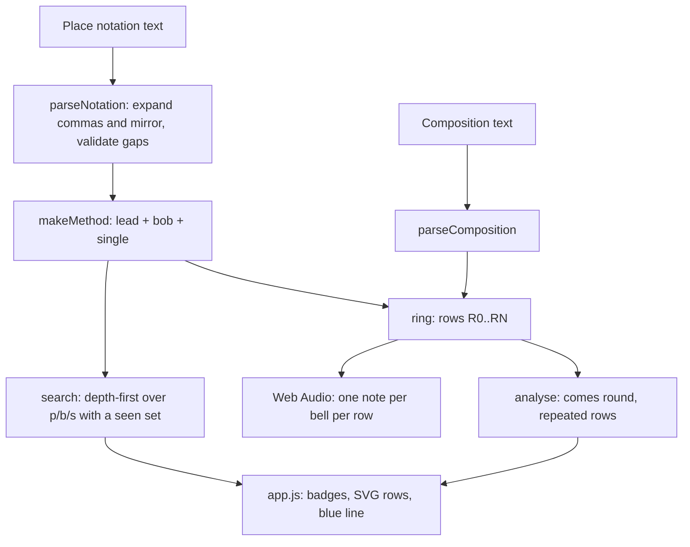

# Change Ringer: How It Works

## Overview
A row is a permutation of bells 1..n. A **change** moves from one row to the next by swapping adjacent pairs, except at the places named in the change. A **method** is a lead of such changes; a **touch** is a list of leads, each plain, bob or single. The engine rings the touch, then tests whether all rows are different and whether the last is rounds.

## Architecture

## File map

| File | Role |
|---|---|
| `src/ring.js` | Engine, works in Node and the browser |
| `src/app.js` | Page wiring, drawing, search panel, sound, share link |
| `index.html` | Page and styles (light and dark) |
| `test/test.js` | Checks and mutants |
| `test/gen.js` | Seeded random cases, writes `oracle_cases.json` |
| `test/oracle.py` | Independent oracle |
| `test/browser.js` | Headless Chromium driver |

## Core mechanisms
- **Place notation.** `x` or `-` swaps every pair; digits list places that stay put; dots separate changes. Any run of free places between fixed ones must be even, so the pairing is unique; otherwise the change is invalid. A comma (or leading `&`) makes each block read forwards then backwards without repeating its turning change, so `&x16x16x16,12` is 11 + 1 = 12 changes.
- **Calls.** A bob or single replaces the last change of a lead with another change.
- **Truth.** With rows R0..RN: if RN = R0, the touch comes round and R0..R(N-1) must be distinct; otherwise R0..RN must be distinct. Repeated rows are grouped by value and shown.
- **Search.** Precompute, for each lead type, the permutation after every change, so each row is `head[P_j[i]]`. The depth-first search keeps a set of seen row keys, adds each lead's rows, abandons the branch on a repeat, and records a touch when a lead ends in rounds. A step budget stops it honestly.
- **Row keys.** Each row is a base-13 integer, so sets are cheap.

## Data and formats
Compositions are strings of `p`, `-`/`b`, `s`. The URL hash is JSON with bells, notation, bob, single, and composition.

## Performance
Plain Bob Minor searched to 12 leads: 199,368 steps in about 270 ms in Node (1591 true touches). The Doubles extent search takes under 10 ms. The page draws at most 1500 rows; longer touches are summarised but only partly drawn.

Related: [[Change Ringer]] · [[Change Ringer - Origin & Decisions]]
