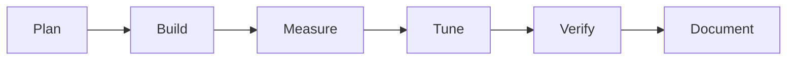

# Chladni Sand: Build Log

## Process

## Steps

1. Wrote `src/plate.js`: mode list, field, seeded RNG, sand step.
2. Wrote the page (canvas, controls, phase overlay) and a test hook `window.__chladni`.
3. Wrote `test/oracle.py` and `test/run.js`.
4. Ran tests, mutated the code twice, fixed two test-design errors (below).
5. Wrote `test/browser.js`, looked at the screenshot, changed the default mix.

## Problems and fixes

| Problem | How it showed up | Change | Result |
|---|---|---|---|
| Oracle picked the wrong discrete eigenvalue for high modes | Fields (4,7) and (1,7) had residual 22 and 5.5 | Look up the eigenvalue by index (`e1[m-1]+e1[n-1]`) instead of nearest to π²(m²+n²) | All 12 residuals about 1e-12 |
| Eigenvalue comparison too strict | Worst error 1.7% at the 30th mode, tolerance 1.5% | Compared the first 20 modes; error is grid discretisation, not a code bug | 1.2% worst |
| Default figure was a plain grid | First screenshot | Default mix 0.8 | Curved Chladni-like figure |

## Verification

`node test/run.js`: 28 passed, 0 failed. `MUTATE=field`: 12 FAIL lines. `MUTATE=sand`: 4 FAIL lines. `node test/browser.js`: 7 passed. I read both screenshots' worth of output for the desktop one (clean curved nodal lines, controls aligned) and the phone check only by the scroll-width test.

## Not verified

- I did not view the phone screenshot visually.
- The browser check "selecting another mode settles" uses a loose threshold and is weak.
- In the page the sand had already settled (mean 0.049) by the first measurement, so the "falls below 50%" check proves little about the page; the Node tests carry that claim.
- Nobody watched the animation; Delight is provisional.
- The figures are not compared with real plates or published Chladni photographs.
- Only Chromium; no Firefox or Safari.

Related: [[Chladni Sand]] · [[Chladni Sand - Origin & Decisions]] · [[Chladni Sand - Lessons & Observations]]
