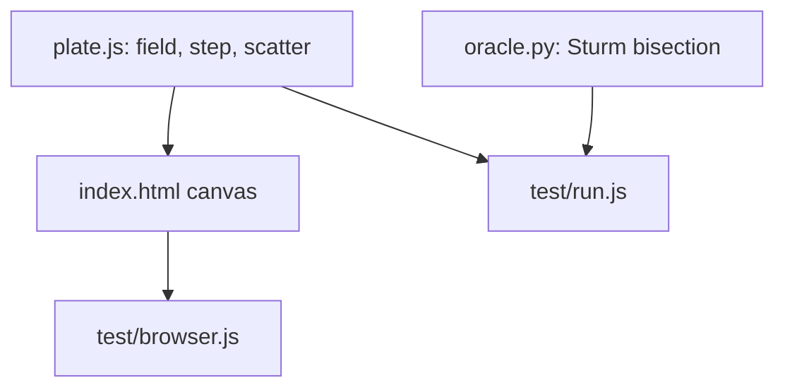

# Chladni Sand: How It Works

## Overview

A pure model module (`plate.js`) and a thin page that draws grains on a canvas each animation frame. The same module is loaded by the Node tests.

## Architecture

## File map

| File | Role |
|---|---|
| `src/plate.js` | Mode list, field function, seeded RNG, sand step |
| `index.html` | Page, controls, drawing |
| `test/oracle.py` | Independent finite-difference eigenvalue and residual oracle |
| `test/run.js` | 28 model checks and mutation switches |
| `test/browser.js` | 7 checks in headless Chromium, screenshots |

## Core mechanisms

- **Mode:** u = sin(mπx)sin(nπy) + s·sin(nπx)sin(mπy). The two terms share the eigenvalue π²(m²+n²), so any mix is still a mode.
- **Sand:** each step moves every grain by a uniform random vector of radius amp·|u|, reflecting at the edges. Where u is 0 the grain does not move, so the nodal set is absorbing in practice.
- **Oracle:** the 1-D Dirichlet Laplacian is tridiagonal; its eigenvalues come from Sturm-sequence bisection. 2-D eigenvalues are sums of pairs. The residual ‖Lv − λv‖/‖v‖ is computed with the 5-point stencil.

## Data and formats

No data files. The RNG is mulberry32, seeded, so sprinkles are reproducible.

## Performance

Not measured formally. 20,000 grains with 2 steps per frame ran in headless Chromium without error; I did not record frame rates.

Related: [[Chladni Sand]] · [[Chladni Sand - Origin & Decisions]]
