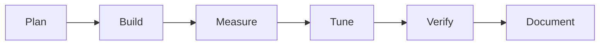

# Cronwise: Build Log

## Process

## Steps

1. Read the playbook and ratings. Node 22, Python 3.11 and Chromium were available; `croniter` was not, so there was no off-the-shelf oracle.
2. Wrote `src/cron.js`: field parser, matcher, fast `next`, English `describe`.
3. Tried 14 expressions by eye. The sparse-hour descriptions were poor, so I rewrote the time-phrase logic.
4. Wrote `test/oracle.py` (separate implementation) and `test/run.js`.
5. Wrote `index.html`, then `test/browser.js`; looked at a screenshot.
6. Wrote the notes, rating and index entries.

## Problems and fixes

| Problem | How it showed up | Change | Result |
|---|---|---|---|
| Ugly English for `*/5 9-17 * * *` | It listed 12 minutes and 9 hours | Recognise `*/N` and hour ranges | "Every 5 minutes during 09:00 to 17:59." |
| Two oracle failures | Mine returned 6 runs, oracle 3 and 5 | Horizons differed (oracle capped at 9 years in total, mine 8 years per search). Not a logic error | Oracle horizon widened to 60 years; all pass |
| Misaligned labels in screenshot | Field names did not sit under the input's characters, and hour labels were off | Replaced with a plain line, and left-aligned hour labels | Checked on the second screenshot |

## Verification

- `node test/run.js`: 444 passed, 0 failed (413 oracle expressions, 5 brute-force chains, 7 semantic cases, 14 rejections, 5 descriptions).
- Mutation: changing the OR day rule to AND gave 333 passed, 111 failed. Restored, back to 444 passed.
- `node test/browser.js`: 11 passed, 0 failed, no console errors, in headless Chromium at 800 px wide.
- Looked at screenshots of the page.

## Not verified

- No comparison against a real `crond` or another cron library.
- The oracle shares an author with the code, so a common misreading of the spec would pass both. I took the OR rule from memory of Vixie cron behaviour.
- Only Chromium, only at one viewport, with no phone layout screenshot and no screen reader.
- English wording is tested on a handful of expressions, not swept. Unusual combinations may read oddly.
- Local-time column depends on the browser zone and was not tested.
- Live GitHub Pages deployment was not fetched at the time of writing.

Related: [[Cronwise]] · [[Cronwise - Origin & Decisions]] · [[Cronwise - Lessons & Observations]]
