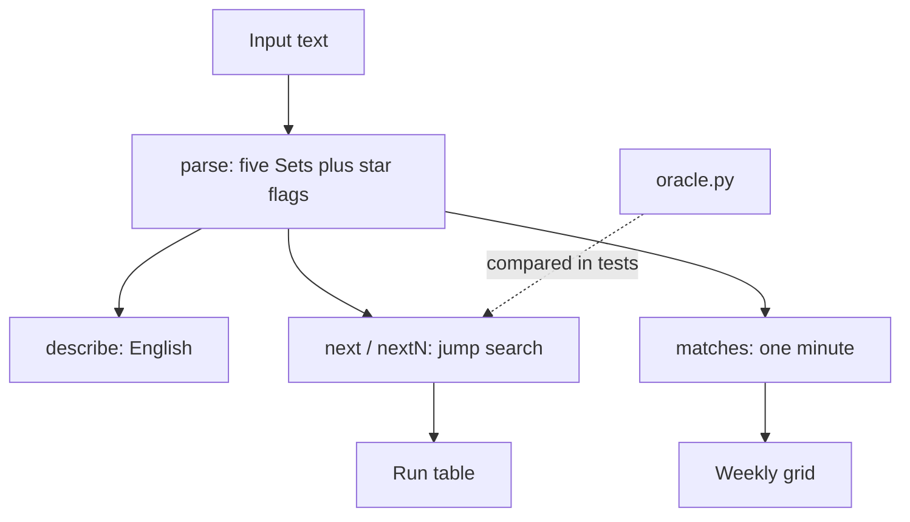

# Cronwise: How It Works

## Overview

A pure-logic module (`src/cron.js`) with no DOM access, used by the page and by the tests. It is loaded as a plain script in the browser and `require`d in Node.

## Architecture

## File map

| File | Role |
|---|---|
| `index.html` | UI: input, chips, table, grid |
| `src/cron.js` | parse, matches, next, nextN, describe |
| `test/oracle.py` | Independent Python implementation, emits JSON cases |
| `test/run.js` | Oracle, brute-force, semantic, rejection and wording tests |
| `test/browser.js` | Headless Chromium checks of the real page |

## Core mechanisms

- **Parse:** each field becomes a `Set` of allowed integers. Names are mapped, `7` becomes Sunday, and errors name the field and value. Whether a day field began with `*` is remembered for the day rule.
- **Day rule:** if both day-of-month and day-of-week are restricted, a day matches when either does. Otherwise both must match, and a `*` always does.
- **Next search:** start one minute after the given time. If the month is wrong, jump to the next month's first day. Then wrong day jumps to the next midnight, wrong hour to the next hour, wrong minute to the next minute. Give up after 8 years, which is why `30 Feb` returns nothing.
- **Weekly grid:** scans the next 35 days, hour by hour, and marks a cell when any allowed minute matches.

## Data and formats

No storage and no network. Dates are UTC `Date` objects. The oracle emits `{expr, start, expect[]}` JSON.

## Performance

Not benchmarked. The tests' 413 expressions × 6 searches run in the order of a second, including starting Python.

Related: [[Cronwise]] · [[Cronwise - Origin & Decisions]]
