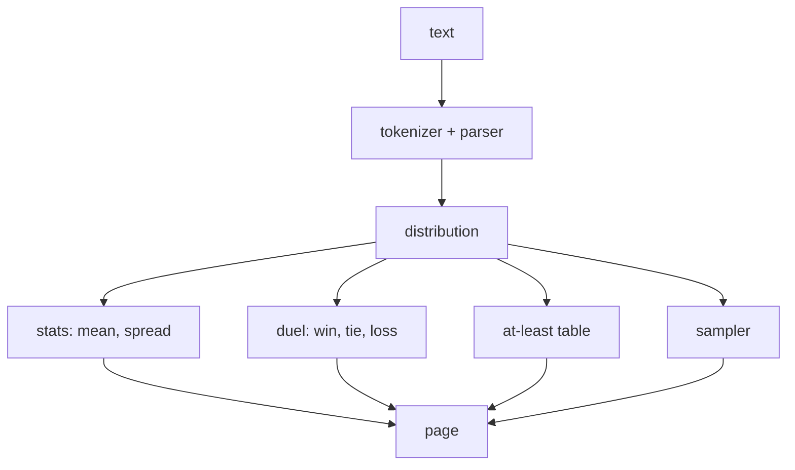

# Dice Duel: How It Works

## Overview

A distribution is a map from total to a BigInt count, plus the grand total of outcomes. Every operator combines two distributions, and the page only ever reads them.

## Architecture

## File map

| File | Role |
|---|---|
| `src/dice.js` | Engine, no dependencies; works as a browser script or a Node module |
| `index.html` | Page: inputs, presets, bar, chart, target table, roll buttons |
| `test/dice.test.mjs` | 9 Node tests |
| `test/oracle.py` | Brute-force enumeration oracle |
| `test/browser.mjs` | Playwright run of the real page |

## Core mechanisms

- **Pools.** For `n` dice of `s` sides keeping the best `k`, faces are visited from best to worst. The state is (dice assigned, kept sum). Giving `c` dice to a face multiplies the weight by C(n−used, c), and the number of newly kept dice is `min(k, used+c) − min(k, used)`. Keep lowest visits faces in the opposite order. Drop highest `h` is keep lowest `n−h`.
- **Operators.** `+`, `-`, `*` convolve two independent distributions. Unary minus negates values.
- **Duel.** Sums count outcomes where A is greater, equal, or less, over `total_A × total_B`.
- **Sampling.** A random number picks a point in the cumulative counts.

## Data and formats

Share links are `#a=<expr>&b=<expr>`, URL-encoded. Nothing is stored or sent anywhere.

## Performance

`30d20kh10` is exact in about half a second; the engine refuses more than 100 dice or 1000 sides, and anything over a 4 million state budget, so typing something huge shows an error instead of freezing the tab. The oracle test over 360 cases takes about 0.3 seconds.

Related: [[Dice Duel]] · [[Dice Duel - Origin & Decisions]]
