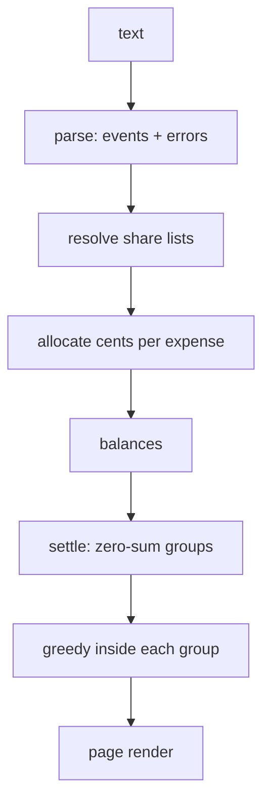

# Even Split: How It Works

## Overview

Text in, balances and transfers out. Everything is pure functions in one file; the page only renders.

## Architecture

## File map

| File | Role |
|---|---|
| `src/split.js` | Parser, rounding, balances, settlement (works in Node and browser) |
| `index.html` | UI, URL-hash state, rendering |
| `test/test.js` | Unit checks, 400-case sweep, runs the oracle |
| `test/oracle.py` | Independent check with `Fraction` and its own search |
| `test/browser.js` | Playwright checks on the real page |

## Core mechanisms

- **Rounding:** each expense is divided with integer weights (hundredths); every share gets the floor and the leftover cents go to the largest remainders, earlier names first. Shares always sum to the amount.
- **Minimum payments:** with n people owing or owed, payments needed = n minus the maximum number of disjoint subsets whose balances sum to zero. A bitmask DP picks the best partition; inside each group a greedy match uses at most size-1 payments.
- **Errors:** a bad line is reported with its number and skipped; the rest still computes.

## Data and formats

Plain text lines. Names are case-insensitive and shown capitalised. `#` starts a comment. State is stored in the URL hash.

## Performance

Bitmask DP is O(3^n) worst case; n is capped at 18 balances, then greedy. The 400-case sweep with the oracle runs in a few seconds; I did not time the 18-person worst case in the browser.

Related: [[Even Split]] · [[Even Split - Origin & Decisions]]
