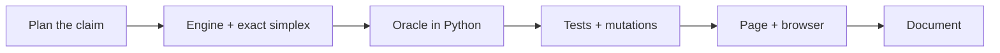

# Fair Rooms: Build Log

## Process

## Steps
1. Decided the claim: for a welfare-maximising assignment, prices that maximise the minimum surplus subject to no envy. Checked two small cases by hand (1200/800 vs 1000/1000 over 2000 gives 1100 and 900, surplus 100).
2. Wrote a fraction type on BigInt, a two-phase exact simplex, the engine and an independent checker (`check`).
3. Wrote the Python oracle: for every assignment, enumerate every choice of n tight constraints, solve with Fractions, keep feasible vertices and the best surplus. It ran about 8 minutes for 420 cases (the 60 four-person cases dominate), so I ran it in the background while writing the page and tests.
4. Wrote the tests, six mutations, the page and a Chromium test.

## Problems and fixes

| Problem | How it showed up | Change | Result |
|---|---|---|---|
| New person added with all-zero bids | Chromium test: "add a person" failed; the page showed the "bid nothing" error | New rows start with equal bids of 1 | Fixed; test passes |
| My test regex did not match my own error text | "negative bid message" failed | Reworded the message ("zero or more") and the regex | Fixed |
| Two mutations crashed the test run instead of failing | Uncaught exception from the engine | Wrapped the oracle and rounding sections in try/catch | All mutations now report a count of failures |
| Awkward summary sentence on the page | Read the first screenshot | Rewrote it as "the least-happy person comes out X ahead" | Fixed |

## Verification
- `node test/test.js`: 22 passed, 0 failed. The oracle comparison covers 420 cases by size 2/3/4 (150/210/60).
- Mutations: price shift forgotten, envy inequality flipped, worst assignment chosen, wrong total row, maximise a price instead of the minimum surplus, checker ignoring the total. Each fails (609, 600, 600, 609, 608 failures and 1 failure respectively). Mutation 3 failing everywhere is itself evidence: with a non-welfare-maximising assignment the LP is infeasible, as the theory says.
- 21 checks in headless Chromium (default solve, highlighted cell is a row maximum, preset claims, editing, add/remove, errors, share link, broken link, HTML escaping, no horizontal scroll at 375 px, no console errors). Read one desktop screenshot.
- Timing: 15 random instances each at 5 and 6 people, all verified envy-free, 9 ms at most.

## Not verified
- Oracle sizes stop at 4 people; 5 and 6 are covered only by the exact checker, which proves envy-freeness and the total but not that the surplus is the best possible.
- The oracle and engine share my formulation of the objective (maximin surplus among envy-free prices). I did not compare against any published implementation.
- Phone layout was checked only for horizontal overflow, not by looking at a phone screenshot. Only Chromium was driven. Nobody has used it.

Related: [[Fair Rooms - Origin & Decisions]] · [[Fair Rooms - Lessons & Observations]] · [[Fair Rooms]]
