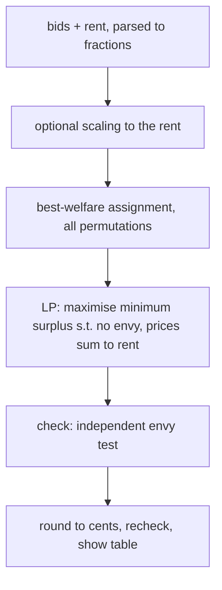

# Fair Rooms: How It Works

## Overview
Bids in, exact envy-free split out. Everything is rational arithmetic on BigInt pairs, so there is no tolerance anywhere.

## Architecture

## File map

| File | Role |
|---|---|
| `src/fair.js` | Fractions, parser, simplex, `solve`, `check`, `toCents` (works as a script or a CommonJS module) |
| `src/app.js` | Page state, grid, rendering, share link in the URL hash |
| `index.html` | Markup and styles |
| `test/test.js` | Hand cases, 600-case sweep, oracle comparison, mutations (`MUTANT=n`) |
| `test/oracle.py` | Independent oracle; `oracle_cases.json` is its output |
| `test/browser.js` | Headless Chromium checks |

## Core mechanisms
- **Why an assignment first.** If prices are envy-free for an assignment, that assignment must maximise total value, so only welfare-maximising assignments need be tried. The oracle does not assume this, and the LP is infeasible for a worse assignment (mutation 3).
- **The LP.** Variables are the prices and the minimum surplus u. Constraints: prices sum to the rent; each person's surplus is at least u; for each person and room, surplus in the given room is at least the surplus in that room. Prices and u are shifted by a large constant so all variables are non-negative; the shift is checked not to bind.
- **Simplex.** Dense tableau with fractions, phase 1 with artificial variables, Bland's rule so it cannot cycle.
- **Rounding.** Exact prices are floored to cents and the missing cents are given to the largest remainders so the total stays exact. The page re-runs the envy test on the rounded prices and warns if a cent-sized envy appears.

## Data and formats
Share link: the state (rent, names, rooms, bid strings) as JSON in the URL hash. A malformed hash falls back to the default example.

## Performance
Under 10 ms for 6 people in 30 trials; the permutation search is 720 cases.

Related: [[Fair Rooms - Origin & Decisions]] · [[Fair Rooms]]
