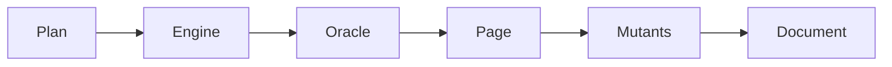

# Gerrymander Lab: Build Log

## Process

## Steps

1. Read the playbook, ratings and lessons; chose the domain (redistricting on small grids) over a gravity sandbox, a rhythm player and a fold-and-cut idea.
2. Wrote the engine: Redelmeier enumeration of connected n-cell sets with a divisibility prune, running seat tallies, `judge`, `analyse`. First run printed 10, 117, 4006, 451206 cuts, which I recognised as the published sequence.
3. Wrote the Python oracle (connected-set listing plus bitmask DP) and a 3×3 brute force; the DP and the engine agreed on the first try, and the 6×6 oracle took 1.7 s.
4. Wrote 10 Node tests. First full run: all pass, 38 s, almost all of it the six 6×6 oracle comparisons.
5. Built the page (SVG grid, pointer painting, table, seat bar, histogram, challenge text), read a desktop screenshot, then wrote 22 Playwright checks.
6. Ran 17 hand-made mutants; fixed three test gaps; rewrote the "your map versus all maps" sentence after a phone screenshot showed "0.0%" for a 1-in-4006 case.

## Problems and fixes

| Problem | How it showed up | Change | Result |
|---|---|---|---|
| Rounded percentage hid rare maps | Phone screenshot said 0.0% for the one map that gives Orange 0 seats | Show counts and "under 0.1%" | Fixed |
| Three mutants survived | `judge` size rule, the per-seat aggregation, and vote-string characters were never exercised | Added three tests (all-connected wrong-size map, aggregate against the oracle histogram, right-length string with bad characters) | All three caught on re-run |
| `no-prune` survived | Removing the divisibility prune changes nothing visible | Left as is: it is a speed-up, dead branches never reach a leaf | Equivalent mutant |
| `anchor` survived | Using a different anchor cell than the lowest free one | Left as is: any free cell as the anchor still counts each partition once | Equivalent mutant (only the order of results changes) |

## Verification

- `node --test test/gerry.test.mjs`: 10 tests, 10 pass (about 38 s). Counts equal 10, 117, 4006, 451206; engine histograms equal the oracle on 60 maps of sizes 3 to 5 and 6 maps of 6×6; the oracle equals a brute force on 8 maps of 3×3; every one of the cuts enumerated for three random maps passes the separate `judge`.
- 17 mutants: 12 caught at once, 3 survived through test gaps (fixed, now caught), 2 equivalent. So 15 of 17 caught and 2 equivalent.
- Browser (Playwright Chromium, 22 checks): start state, challenge text, best-map button, drag painting, erase, voter flip, shuffle share, share-link round trip, corrupt link fallback, four sizes, 6×6 count in the page (451,206), 375 px width, no console errors. Screenshots of desktop, 6×6 and phone were read.
- Deliberate failures: the mutants are the proof the tests can fail; 15 of 17 made the suite fail (the 3 late catches only after the new tests).

## Not verified

- Firefox and Safari. Touch painting was only emulated with hasTouch and no real touch drag.
- Keyboard and screen-reader use: not supported.
- The seat sentence's wording for ties and for exactly even voter splits was read but not tested.
- Nobody else has used it.

Related: [[Gerrymander Lab]] · [[Gerrymander Lab - Origin & Decisions]] · [[Gerrymander Lab - Lessons & Observations]]
