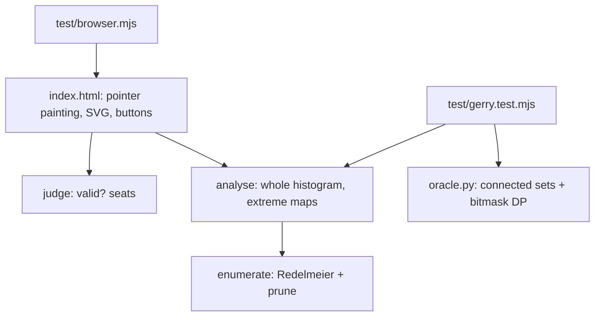

# Gerrymander Lab: How It Works

## Overview

The engine (`src/gerry.js`) has no DOM code. `enumerate` visits every way to cut the n×n grid into n connected districts of n cells; `analyse` runs it for one vote map and keeps a histogram of (orange seats, teal seats) plus the best and worst maps; `judge` validates and scores a map drawn by a person. The page draws an SVG grid and calls these.

## Architecture

## File map

| File | Role |
|---|---|
| `index.html` | Page, SVG drawing, pointer events, share link in the address bar |
| `src/gerry.js` | Engine: neighbours, winner, judge, enumerate, analyse, vote string codec |
| `test/oracle.py` | Independent counter (set listing, bitmask DP) and a 3×3 brute force |
| `test/gerry.test.mjs` | 10 Node tests |
| `test/browser.mjs` | 22 Playwright checks, serves the folder itself |

## Core mechanisms

- **Enumeration.** The lowest free cell must start the next district, so districts come out in a canonical order and each unordered partition appears once. The connected n-cell sets containing that cell are listed with Redelmeier's algorithm (each connected set exactly once, using an "untried" frontier and a mark array). After each district, every free region must have a size divisible by n; otherwise that branch cannot finish and is dropped. Without this pruning the result is the same but the search wastes time on dead ends.
- **Seat tally on the way down.** Each finished district updates (A seats, B seats) as it is placed, so a leaf costs almost nothing.
- **Winner.** 2k > n is orange, 2k < n is teal, otherwise a tie and no seat.
- **Challenge text.** If one party has under half the voters, the page compares the other side's best possible seat count from the histogram with a majority, and says "It can be done" or reports the best achievable.
- **Share link.** `#n=5&v=<0/1 per cell>&a=<district digit or . per cell>`; a malformed link falls back to the default.

## Data and formats

Votes: array of 0/1 (1 is orange). Assignment: array of district ids 0..n-1 or -1. Both are strings in the URL.

## Performance

Measured in Node 22: 3×3 about 1 ms, 4×4 3 ms, 5×5 about 25 ms, 6×6 about 2 s for 451,206 cuts (6×6 oracle in Python: about 1.7 s). The page recounts on every voter change for sizes up to 5; size 6 waits for a button.

Related: [[Gerrymander Lab]] · [[Gerrymander Lab - Origin & Decisions]]
