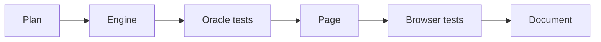

# Harmonograph: Build Log

## Process

## Steps

1. Wrote the pure engine (`src/engine.js`): pendulum maths, sampling, interval naming, SVG, share-link codec, seeded random designs, presets.
2. Wrote `test/test.js`: RK4 oracle, superposition, decay, Lissajous crossing count, codec, cents, SVG, bounds, presets, determinism, plus six mutants.
3. Wrote the page and `test/browser.js` (Playwright Chromium), read desktop and 375 px screenshots.

## Problems and fixes

| Problem | How it showed up | Change | Result |
|---|---|---|---|
| A stray `cat > /tmp/x.js` in a command waited on stdin | The first command hung for 2 minutes | Killed it, re-ran | Engine fine |
| `randomPends` could return a pitch above the 8 Hz limit the share-link codec accepts | 13 of 50 round-trip checks failed | Clamp pitches in the generator | All pass |
| My preset test claimed "a slightly sharp fifth" | Preset has 3 against 2.004, which is flat | Derived the claim from the ratio, test now asserts flat by 3.46 cents | Pass |
| Lissajous count for 4:5 was 30 not 31 at phase 17° | A formula check failed, 4x finer sampling gave the same | Scanned 8 phases: 9 of 72 counts were one low | Test now asserts the formula is reached and never exceeded; not explained |

## Verification

Engine: 86 checks pass. Mutants (decay, phase, axis, cents, svgflip, clampf) each fail 1 to 8 checks. Browser: 25 checks pass in headless Chromium, and I read desktop and 375 px screenshots (curves drawn, no overflow).

## Not verified

- Why the crossing count dips by one at some phases (a near-tangent or coincident crossing is my guess; unconfirmed).
- Feel, speed on a real phone, Firefox/Safari, touch dragging (only mouse was driven), a person's reaction.
- The "weakest" mutant, clampf, was caught by only 1 check.

Related: [[Harmonograph]] · [[Harmonograph - Origin & Decisions]] · [[Harmonograph - Lessons & Observations]]
