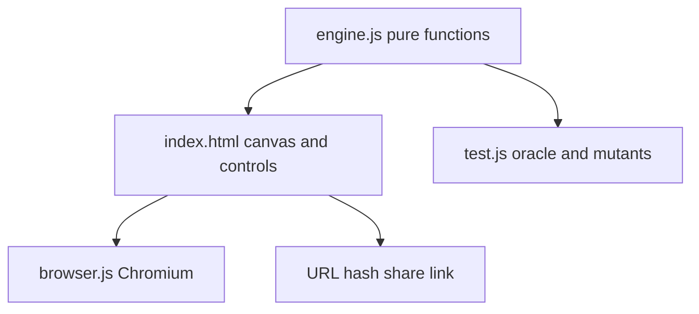

# Harmonograph: How It Works

## Overview

The pen position at time t is x(t) = sum of two x pendulums, y(t) = sum of two y pendulums, each `a·sin(2πft + φ)·e^(−dt)`. The page steps t in 0.005 s increments up to 60 s and draws line segments.

## Architecture

## File map

| File | Role |
|---|---|
| src/engine.js | All maths and codecs; works in the browser and Node |
| index.html | Canvas drawing, controls, drag, export |
| test/test.js | Engine checks and mutants |
| test/browser.js | Real-browser checks and screenshots |

## Core mechanisms

- **Interval read-out:** finds the simple ratio p:q (q up to 12) nearest f1/f2, preferring small numbers, and reports `1200·log2(r/(p/q))` cents.
- **Drag:** raises or lowers the first horizontal and first vertical pitch, restarts, and draws the first 12 s at once so the new shape shows.
- **Share link:** `axis:a:f:p:d` ×4 joined by `_`, parsed strictly and clamped; bad input falls back to a random design.
- **Random designs:** seeded (mulberry32); the main pair picks a simple ratio and a small detune, so shapes close up slowly.

## Data and formats

URL hash and a plain SVG path (one `M` then `L`s, 12,001 points for 60 s).

## Performance

Not measured. By arithmetic, 12,000 points at 32 points per frame (default speed 4) is about 375 frames, roughly 6 seconds at 60 fps; no frame-time measurement was taken and a slow device was not tried.

Related: [[Harmonograph]] · [[Harmonograph - Origin & Decisions]]
