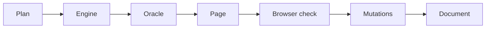

# Knotwork: Build Log

## Process

## Steps
1. Worked out the segment model on paper: which neighbour segment each segment end continues into, and what happens at a wall. Wrote `src/knot.js`.
2. Checked the gcd law at once: 144 sizes, 0 bad (later 576).
3. Wrote `test/oracle.py` (billiard on a half-unit lattice, union-find over directed states and their reverses) and `test/test.js`.
4. Built `index.html` and `test/browser.js`; read desktop and phone screenshots plus a 12 x 8 multi-strand screenshot.
5. Ran four mutations.

## Problems and fixes

| Problem | How it showed up | Change | Result |
|---|---|---|---|
| My expectation for a 6 x 4 grid was wrong | One test failed: I had guessed 60 and 36 | Worked out 96 segments split evenly, expected 48 and 48 | Test now correct; the engine was right |
| Mutation of the four-fold rotation survived | 19 checks still passed with a shifted rotation | Added a test that rotates the edge ends 90 degrees independently | Mutant now fails |
| Playwright click on a re-rendered element | "Element is not attached" | Re-query the element at each click | Browser test passes |
| Symmetry select overflowed its panel | Seen in the desktop screenshot | `max-width` on the select | Fixed (not re-screenshotted at desktop size) |

## Verification
- `node test/test.js`: 19 passed, 0 failed. Includes 576 gcd sizes, 1,500 random grids against the oracle (count, lengths, alternation), segment partition, symmetry orbit checks, solver results confirmed by the oracle, share-link round trips, SVG shape.
- `node test/browser.js`: 16 passed, 0 failed (strand counts after clicks equal the engine's, the address hash restores the drawn grid, SVG download is clean, no page errors, no horizontal scroll at 390 px).
- Mutations: wrong parity rule caught (1,369 alternation violations); wall partner returning itself caught; wrong neighbour table caught (crash); rotation shift caught only after the test was strengthened.

## Not verified
- Nobody else has used it; whether the knots look good to others is unknown (I read screenshots only).
- Only Chromium; no Firefox or Safari.
- The weave rule was checked for consistency (alternation round each strand), not against a reference drawing. Both implementations use my rule, so a mirror-image weave would pass.
- No keyboard or screen-reader way to place walls.
- Large grids (up to 16 x 16 in the UI) were not timed in the browser; the solver was only run to 12 x 12.
- The solver failing under a symmetry does not prove no solution exists.

Related: [[Knotwork]] · [[Knotwork - Origin & Decisions]] · [[Knotwork - Lessons & Observations]]
