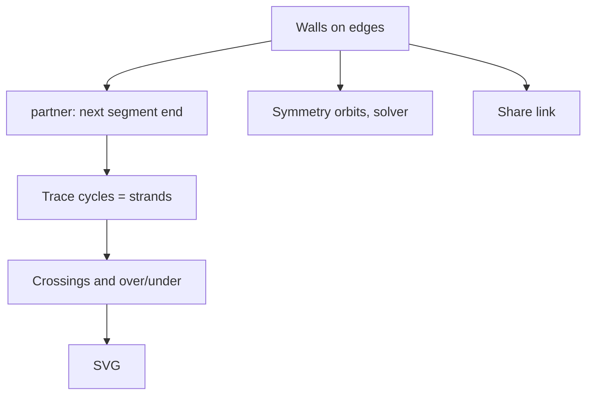

# Knotwork: How It Works

## Overview
A grid of W x H squares. Each square holds four diagonal segments, each joining the midpoints of two adjacent sides: NE, SE, SW, NW (named for the corner they cut off). Strands are the cycles you get by following segments end to end.

## Architecture

## File map
| File | Role |
|---|---|
| `src/knot.js` | Engine: grid, tracing, weave, symmetry, solver, share link, SVG |
| `index.html` | UI and event wiring (loads the engine with a relative URL) |
| `test/test.js` | Node checks, calls the oracle |
| `test/oracle.py` | Independent billiard oracle |
| `test/browser.js` | Headless Chromium drive |

## Core mechanisms
- **Continuation.** A segment end that meets no wall continues straight into the neighbouring cell (for example NE ends continue into SW segments above and to the right). At a wall it joins the other segment of the same cell that shares that end, which is a bounce.
- **Strands.** Walk from an unvisited segment, linking ends, until the start returns. Every segment ends on exactly one strand.
- **Weave.** At each non-wall midpoint exactly two strands cross. The "/" strand is on top when floor((X-Y)/2)+floor((X+Y)/2) is even. Along a "/" strand X+Y is constant, along a "\" strand X-Y is, so over and under alternate along both.
- **Symmetry.** Edges map to mirror images in midpoint coordinates; toggling sets the whole orbit.
- **Solver.** Random walls, then single-orbit toggles kept when the strand count does not rise, with restarts, seeded and deterministic.
- **gcd law.** With no inner walls the strands are diagonal billiard paths in an a x b box, so there are gcd(a,b) of them.

## Data and formats
Share link: `WxH-sym-hex`, where hex packs the interior wall bits (4 per digit) in a fixed edge order; invalid strings are rejected.

## Performance
Tracing is linear in 4WH. A full analysis of a 16 x 16 grid is about a thousand segments, fast enough that the solver runs hundreds of analyses in well under a second. I did not time it carefully.

Related: [[Knotwork]] · [[Knotwork - Origin & Decisions]]
