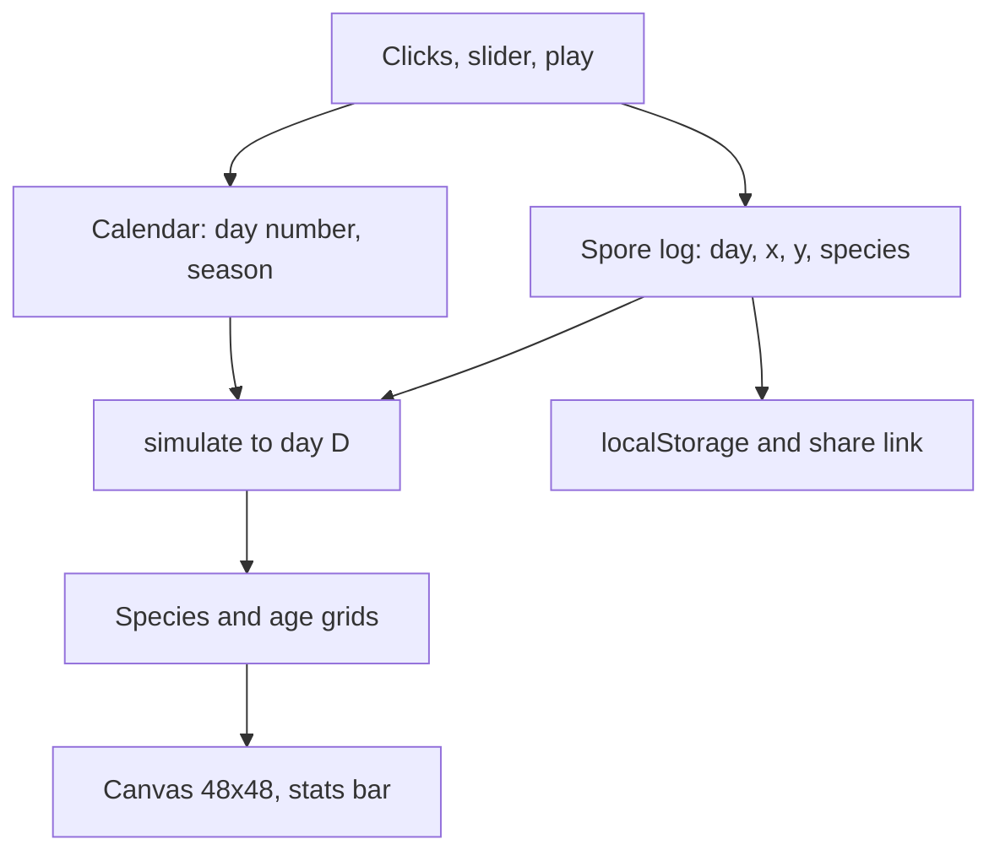

# Lichen Garden: How It Works

## Overview

A pure engine computes the garden on any day from the empty world plus the spore log. The page only draws that state, takes clicks and stores the log.

## Architecture

## File map

| File | Role |
|---|---|
| `src/lichen.js` | Engine: hash, season, step, simulate, digest, spore codec |
| `index.html` | Page, drawing and controls (inline module) |
| `test/lichen.test.mjs` | Nine Node tests including the oracle comparison |
| `test/oracle.py` | Independent Python re-implementation |
| `test/browser.mjs` | Real Chromium check |

## Core mechanisms

- **Hash randomness.** `mix(day, cell, salt)` is three rounds of multiply-xorshift in 32-bit integers. Each decision uses its own salt (growth 1, tie 2, age 3, overtake 4, frost 5).
- **Season.** `warmth = 180 - |phase - 180|` with phase from the day number; midwinter is day 25 (about 21 Dec). Growth chance per occupied neighbour is `(16 + warmth) / 16` out of 256, frost starts below warmth 30.
- **Competition.** A cell goes to its predator species (species mod 3 + 1) when three or more neighbours belong to it, one day in eight.
- **Time travel.** There is no stored history. Any day is recomputed from day 0; the page reuses the current state when moving forward.
- **State digest.** FNV-1a over species and age, used to compare implementations and the page.

## Data and formats

Spore log: `day.x.y.species` joined by `~`, in `localStorage` and in the share link (`#s=`). Decoding drops malformed entries, rejects days at or above 100000 and caps the list at 2000.

## Performance

A full year (365 steps of 2304 cells) takes about 56 ms in Node, so the slider recomputes from day 0 on every drag when going backwards. The Python oracle takes about 0.8 s for 200 days.

Related: [[Lichen Garden]] · [[Lichen Garden - Origin & Decisions]]
