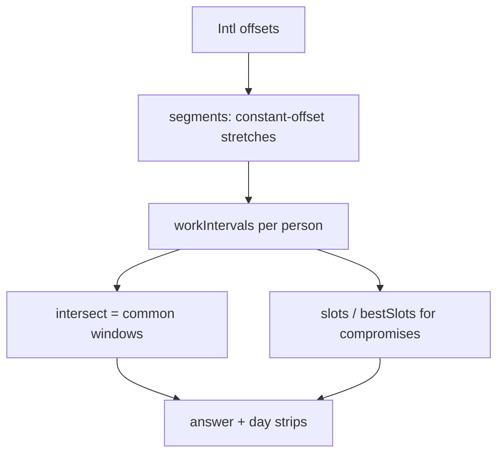

# Overlap: How It Works

## Overview

Everything is integer milliseconds since the epoch, always whole minutes. For each person the code builds a sorted list of working intervals in UTC; shared time is the intersection of those lists.

## Architecture

## File map

| File | Role |
|---|---|
| `src/overlap.js` | The core, UMD so Node tests and the page share it |
| `src/app.js` | Form, URL state, answer text, day strips |
| `index.html` | Page and styles |
| `test/test.js` | Hand-derived facts, mutation hook, sweep that feeds the oracle |
| `test/oracle.py` | Minute-by-minute `zoneinfo` oracle |
| `test/browser.js` | Playwright checks of the real page |

## Core mechanisms

- `offsetAt` formats an instant in the zone with `Intl.DateTimeFormat` and subtracts the epoch seconds, giving minutes east of UTC.
- `segments` steps through the range hourly, and when the offset changes it bisects between the two hours to the exact minute. Each stretch has a fixed offset, so inside it local time is just UTC plus a constant.
- `workIntervals` walks each stretch in local-wall space, day by day. For each allowed weekday it takes [day + start, day + start + length), clipped to the stretch, and converts back. Because every stretch is clipped separately, a window that spans a DST change is cut and re-joined correctly, and a start time inside a spring-forward gap simply begins when the clocks jump.
- `intersect` is a two-pointer sweep. `bestSlots` tests 15-minute UTC starts, merges runs with the same verdict.
- `localToInstant` finds the first instant at which a zone's wall clock reads a time (used to find local midnights for the day strips).

## Data and formats

State is `{people:[{name,zone,start,end,days}], from, weeks, len, view}` as JSON in the URL hash. Nothing else is stored.

## Performance

A 4-week view of 6 people recomputes in a few milliseconds per keystroke (not formally measured). The sweep of 160 cases through the oracle takes about 6 s in total, dominated by Python.

Related: [[Overlap]] · [[Overlap - Origin & Decisions]]
