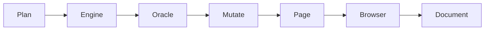

# Rankwise: Build Log

## Process

## Steps

1. Read the playbook, ratings and lessons; picked the domain.
2. Wrote `src/vote.js` (parser, pairwise matrix, six methods).
3. Wrote `test/oracle.py` independently, then `test/test.js` with hand cases, parser cases, a literature example and a 3,000-case sweep.
4. Ran 8 mutations on the engine.
5. Wrote the page, then `test/browser.js` (Playwright, Chromium), read desktop and phone screenshots.

## Problems and fixes

| Problem | How it showed up | Change | Result |
|---|---|---|---|
| My hand-written pairwise matrix was wrong | Test failed on the partial-ballot case | Re-derived by hand: B beats C 3 times, not 2 | Test fixed; engine was right |
| Literature check compared by index | Failed because candidates are ordered by first appearance | Compare by name | Passes |
| I thought "A > B" then "C" was invalid | Rejection test failed | A one-name ballot is legal; removed the case | Fixed |
| "Lunch split" preset did not show disagreement | Browser test "rules disagree" failed | Searched for data where plurality differs | New data (5/4/3) |
| "Spoiler" preset comment claimed something false | Engine showed all six agree | Searched for a real center squeeze; renamed "Squeeze" | Verified: plurality and IRV pick Left, others Mid |

## Verification
- `node test/test.js`: 15 passed, 0 failed; sweep of 2,830 cases in about 1.3 s, with 595 disagreeing, 349 without a Condorcet winner and 410 with ties.
- Mutations (all caught, 1 or 2 failures each): Schulze `>=` to `>`; IRV majority `>` to `>=`; Borda tie term removed; unlisted position changed; minimax margin dropped; IRV eliminating only one of the tied; Schulze path min removed; Copeland tie half-point removed.
- `node test/browser.js`: 21 passed, 0 failed (presets match the engine, escaping of HTML in names, share link, malformed hash, no page errors, no horizontal scroll at 390 px).
- Desktop and phone screenshots read.

## Not verified
- Only Chromium; no Firefox or Safari.
- The oracle shares my rule conventions (see Value & Future). I did not compare with any third-party voting library.
- No real user has tried the input format.
- Screen reader behaviour and keyboard use were not tested beyond default controls; contrast was not measured.

Related: [[Rankwise]] · [[Rankwise - Origin & Decisions]] · [[Rankwise - Lessons & Observations]]
