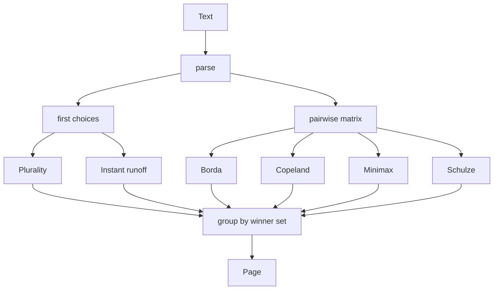

# Rankwise: How It Works

## Overview
A pure engine (`src/vote.js`) and a thin page. The engine parses text into ballot groups `{count, ranks}` and computes everything from one pairwise matrix `d[a][b]` (voters ranking a above b, unlisted tied last) plus first-choice tallies.

## Architecture

## File map

| File | Role |
|---|---|
| `src/vote.js` | Parser, pairwise matrix, six methods, Condorcet winner, `analyze` |
| `index.html` | Page: textarea, presets, cards, matrix, IRV rounds, share link |
| `test/test.js` | Hand, parser, literature, sweep and law checks |
| `test/oracle.py` | Independent brute-force implementation |
| `test/browser.js` | Playwright run against the real page |

## Core mechanisms
- **Pairwise:** for each ballot group, positions are the listed rank, or the list length for unlisted options.
- **Borda:** doubled integer points (win 2, tie 1) per pairing, halved for display, so no floating-point error.
- **IRV:** repeatedly tally each ballot's highest still-alive listed option; stop when one has more than half of counted votes; otherwise eliminate all tied-lowest options.
- **Schulze:** path strengths by Floyd-Warshall on winning-vote edges; winners are those not beaten by any rival's path.
- **Winners are sets**, so ties are explicit.

## Data and formats
`count: A > B > C` lines, `#` comments. The address-bar hash holds the URI-encoded text.

## Performance
The 2,830-case sweep (engine and oracle) runs in about 1.3 s. 12 options with large counts are instant because the work depends on groups, not voters. The oracle expands voters and enumerates paths, so it is only for small cases.

Related: [[Rankwise]] · [[Rankwise - Origin & Decisions]]
