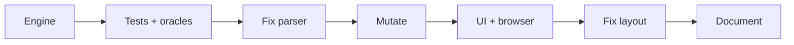

# Regex Twins: Build Log

## Steps
1. Wrote `src/regex.js` (parser, Thompson NFA, subset construction, Moore minimisation, product comparison, counting, finiteness, edge labels). A hand check of `(a|b)*abb` gave the textbook 4 live states.
2. Wrote `test/test.js` (hand facts, native sweep, equivalence sweep, Python oracle) and `test/oracle.py`.
3. Page `index.html`, then `test/browser.js`; read desktop and 390 px screenshots.

## Problems and fixes
| Problem | How it showed up | Fix |
|---|---|---|
| Parser treated a leading `]` as a literal (Python style), so `[^]` threw | First test run crashed | JS semantics: `[]` empty, `[^]` anything; my hand test expectation changed accordingly |
| Parser accepted stacked quantifiers (`a{0,2}*`) that JS rejects | Test generator built such a pattern and native `RegExp` threw | Quantifier loop runs once; `a**` now an error. Test generator wrapped in `(?:...)` |
| Browser test: empty-string example not visible in `innerText` (CSS pseudo-element) | 1 failure | Test checks for the element instead |
| Browser test: same-URL hash navigation does not reload | 2 failures | Added `reload()` |
| Horizontal scroll at 390 px (419 px wide) | Scroll-width check | `min-width:0; overflow-x:auto` on cards |
| Machine labels for `\w` were a long "not ␣–/ :–@ ..." string | Read the screenshot | Label named classes `\w`, `\W`, `0–9`, `\D` |

## Results
- `node test/test.js`: 800 passed, 0 failed (4 s). Native sweep: 20,588,550 pairs, 114,893 accepted, 0 mismatches. Equivalence: 200 pairs (150 equal, 50 different). Python `re`: 100 regexes, 4000 strings, 0 mismatches.
- Mutations: each of five caught. The "minimisation stops early" mutation is a blunt one (everything fails); a subtler minimisation bug would be less certain to show.
- `node test/browser.js`: 16 passed, 0 failed.

## Not checked
- Firefox, Safari, real phones (only a 390 px Chromium viewport).
- Regexes outside the generator's grammar (long classes, nested counted repeats near the limit of 50, state blow-up cases near the 5000 state guard).
- Performance on adversarial patterns such as `(a|b)*a(a|b){12}` (exponential DFA); the guard exists but I did not time it.
- The brute-force check on "equal" verdicts is limited to strings up to length 6 over 7 characters.
- Screen reader and keyboard behaviour, beyond that it uses native inputs and buttons.
