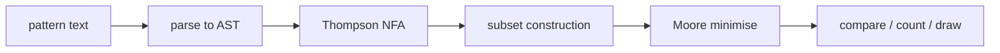

# Regex Twins: How It Works

## Files
- `src/regex.js` (about 330 lines, UMD): `compile`, `accepts`, `examples`, `countByLength`, `isFinite`, `compare`, `edges`.
- `index.html`: the page, inline script and styles.
- `test/test.js`, `test/oracle.py`, `test/browser.js`.

## Mechanisms
- **Sets** are 95-element boolean arrays over codes 32 to 126. `\d \w \s` and negations, ranges and `[^...]` all reduce to sets.
- **NFA:** counted repeats `{n,m}` are expanded by copying the sub-automaton (limit 50) so the rest of the pipeline only sees union, concatenation and star.
- **DFA:** subset construction with one transition per character (95 columns), so no alphabet partitioning is needed. A guard stops at 5000 states.
- **Minimisation:** Moore partition refinement until the class count stops growing; states are renumbered breadth-first, so equal languages produce identical machines (a useful visible sign: "twins" show the same drawing).
- **Compare:** breadth-first search over pairs of states; the first pair whose acceptance differs gives the shortest string, tracked separately for "only A" and "only B".
- **Counting:** a dynamic programme over state counts with BigInt gives the exact number of matches per length (e.g. `..` is 9,025 at length 2).
- **Finiteness:** a cycle among states that are reachable and can still reach acceptance means infinitely many matches.
- **Drawing:** layers by BFS depth, quadratic curves, self-loops, dead state omitted; capped at 14 states.

## Performance
The 800 checks including 20 million native matches run in about 4 s. Patterns whose DFA is exponential (e.g. `(a|b)*a(a|b){10}`, 2^10 states) work but were not timed carefully.
