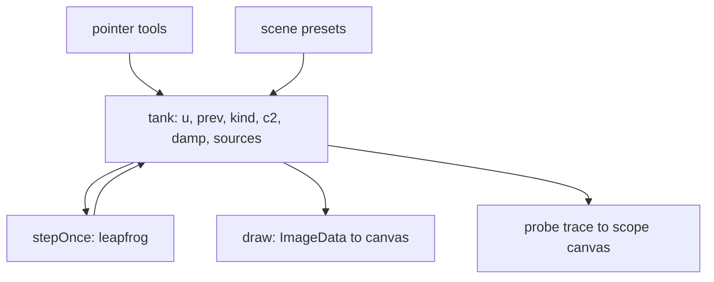

# Ripple Tank: How It Works

## Overview
The water height u on a grid follows u_tt = c^2 times the sum of the four neighbours minus 4u, stepped with leapfrog: next = 2u - prev + c2 * lap (c2 is the squared Courant number, 0.25 deep and 0.09 shallow, stable up to 0.5).

## Architecture

## Mechanisms
- **Walls:** cells of kind 1 are set to 0 each step, so waves reflect with a sign flip.
- **Shallow water:** cells of kind 2 use the smaller c2, so the wavelength shrinks by 0.6.
- **Open edges:** a damping ramp over 18 cells (up to 0.12 per step) absorbs outgoing waves; the outer ring is fixed at zero.
- **Wave makers:** a point source adds a sine acceleration each step. The plane-wave scenes use a line of in-phase makers.
- **Stone:** a cosine bell added to u and prev (no initial velocity).
- **Drawing:** u is soft-clipped to between -1 and 1 and mapped to a colour ramp; walls are grey, shallow water is lighter.

## Files
- `src/wave.mjs`: the engine, pure, runs in Node and the browser.
- `index.html`: page, tools and loop.
- `test/wave.test.mjs`, `test/browser.mjs`: checks.

## Performance
38,400 cells; one step in Node takes well under a millisecond; the page does 1 to 6 steps per frame. Measured only in headless Chromium.
