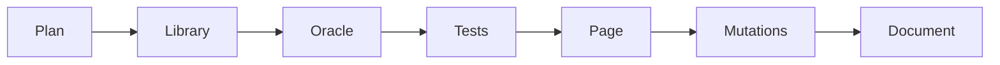

# Sandpile Identity: Build Log

## Process

## Steps

1. Wrote `src/sandpile.js`: bulk toppling, parallel step, identity, burning test.
2. Wrote `test/oracle.py`: slow stabiliser, identity, brute-force recurrent closure, Fraction-based determinant of the grid Laplacian.
3. Wrote `test/test.js` (134 checks). First run passed with no fixes needed.
4. Built the page and a Chromium test (17 checks); read desktop and phone screenshots.
5. Ran 4 deliberate mutations.

## Problems and fixes

| Problem | How it showed up | Change | Result |
|---|---|---|---|
| Stage card stretched taller than the canvas | Blank white area under the grid in the wide screenshot | `align-self:start` | Fixed; not re-screenshotted afterwards |
| First mutation to the burning test survived | 134 passed | Reasoned it is equivalent (a cell cannot topple twice in burning from a stable pile) and replaced it with two non-equivalent ones | Both caught |

## Verification

- `node test/test.js`: 134 passed, 0 failed (about 9 s).
- `node test/browser.js`: 17 passed, 0 failed, including 101x101 identity in under 4 s.
- Mutations: leaky edge 70 pass / 64 fail; wrong identity start 89/45; burning without top/bottom sink 102/32; recurrence shortcut 131/3.
- Read desktop (43x43) and phone (101x101) screenshots.

## Not verified

- Identity vs oracle only to 25x13; beyond that only algebraic properties.
- Chromium only; no Firefox or Safari; no real touch device.
- Animation smoothness never measured; only that it settles.
- The layout fix was not screenshotted again.
- No one else has used it.

Related: [[Sandpile Identity]] · [[Sandpile Identity - Origin & Decisions]] · [[Sandpile Identity - Lessons & Observations]]
