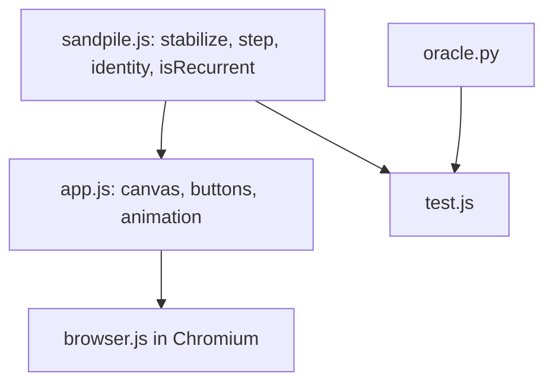

# Sandpile Identity: How It Works

## Overview

A grid of integers. Toppling is the only dynamic. The library is pure functions on `Int32Array`; the page is a thin canvas and button layer.

## Architecture

## File map

| File | Role |
|---|---|
| `src/sandpile.js` | Library, loadable in Node and the browser |
| `src/app.js` | UI and animation |
| `index.html` | Layout and styles, light and dark |
| `test/oracle.py` | Independent slow implementation and group brute force |
| `test/test.js`, `test/browser.js` | Checks |

## Core mechanisms

- **Stabilize:** stack of unstable cells; each topples floor(v/4) times at once. The abelian property means order does not matter.
- **Identity:** e = s(2c - s(2c)) with c all 3s.
- **Burning test:** add to each cell the number of sink edges it touches, stabilize; recurrent iff every cell toppled exactly once.
- **Animation:** one parallel round per step, several per frame (speed slider).

## Data and formats

Flat `Int32Array`, index y*w+x, values 0-3 when stable.

## Performance

101x101 identity plus the checks run in under 4 s in headless Chromium including page overhead (the test asserts this bound; the exact time was not recorded). Node suite: about 9 s, mostly the Python oracle's brute force.

Related: [[Sandpile Identity]] · [[Sandpile Identity - Origin & Decisions]]
