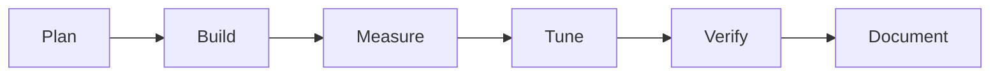

# Stamp Lights: Build Log

## Process

## Steps

1. Checked the toolchain: Node 22, Python 3.11, Playwright Chromium. No numpy (not needed).
2. Wrote `src/lamp.js`: PRNG, stamp generator, press masks, GF(2) solver, puzzle maker. Smoke test: 20 puzzles per level solved in 5 to 18 ms.
3. Wrote the oracle (BFS over all states) and a test that exports cases as JSON for it.
4. Ran mutations on the solver.
5. Built the page, then a Playwright test, then read desktop (900px) and mobile (390px) screenshots.
6. Wrote the notes, rating and lessons.

## Problems and fixes

| Problem | How it showed up | Change | Result |
|---|---|---|---|
| My unit test for "unsolvable board" was wrong | 1 failure: a 2x1 board with a clipped stamp is solvable | Replaced it with the classic 4x4 plus stamp, which has nullity 4 | Passes; the oracle covers unsolvable boards properly |
| Mutation 1 only produced 18 oracle disagreements in 2480 | Most puzzles have a unique solution, so "first" equals "minimum" | Kept the sweep with many random stamps; noted the weakness | Mutation still caught |

## Verification

- `node test/test.js`: 13 passed, 0 failed (about 9 s). Mean par: easy 5.11, medium 6.74, hard 8.89 over 150 seeds each.
- Oracle: 2480 boards checked (128 unsolvable), 0 disagreements.
- Mutations: first-solution instead of minimum (oracle failed, 18 disagreements); stamp wraps (2 failures); unsolvable check removed (3 failures, 128 disagreements). Source restored and diffed afterwards.
- `node test/browser.js`: 15 passed. It presses cells, undoes, follows Hint to a win in exactly par presses, resets, reloads from the link, switches level, checks the 390px page has no horizontal scroll.
- Looked at both screenshots; layout fine.

## Not verified

- No one played it. Whether the difficulty levels feel right, or whether par is a satisfying target, is unknown.
- The oracle cannot reach 5x5 or 6x6, so minimality there rests on the same algebra verified at smaller sizes.
- Only Chromium; no Firefox, Safari or real touch device. Keyboard navigation was not tested beyond focus preview existing. Screen-reader behaviour was not tested.
- Dark mode was not looked at.
- Whether the daily seed rolls over correctly in other timezones was not tested.

Related: [[Stamp Lights]] · [[Stamp Lights - Origin & Decisions]] · [[Stamp Lights - Lessons & Observations]]
