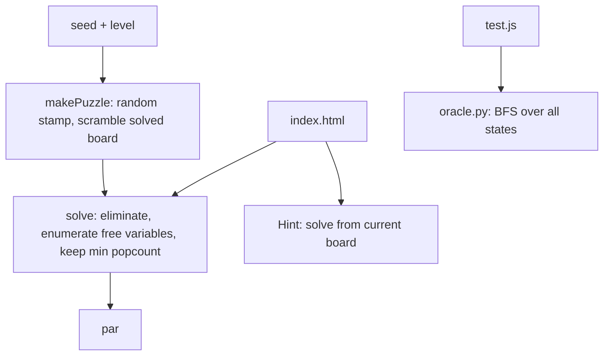

# Stamp Lights: How It Works

## Overview

A board is a bit vector (BigInt, bit `y*w+x`). Pressing cell c XORs in a mask: the stamp placed at c, clipped to the board. Because XOR commutes and cancels, a solution is a set of cells to press once each, and solving is a linear system A x = b over GF(2), where column j of A is the mask of cell j.

## Architecture

## File map

| File | Role |
|---|---|
| `src/lamp.js` | RNG, stamps, masks, solver, puzzle generator (works in Node and the browser) |
| `index.html` | Board, controls, hover preview, hint, URL seed |
| `test/test.js` | Unit checks, seeded sweeps, oracle export |
| `test/oracle.py` | Independent BFS oracle |
| `test/browser.js` | Playwright end-to-end checks |

## Core mechanisms

- **Elimination:** rows are BigInts with the target in bit n. Gauss-Jordan finds pivots; a zero row with target 1 means unsolvable.
- **Minimum:** with d free columns there are 2^d solutions. All are enumerated (capped at d = 20) and the one with fewest presses wins.
- **Puzzle generation:** pick a connected random stamp inside a 5x5 window, apply k random presses to a solved board, and keep it if the true minimum is at least the level's threshold (3, 5, 7).
- **Hint:** re-solve the current board and highlight the first press of a minimum solution, so it is valid after the player's mistakes.

## Data and formats

URL hash `#level/seed`. Stamp is a list of `[dx, dy]` offsets including `[0,0]`.

## Performance

Generating a puzzle and solving it takes 0.3 to 1 ms for 4x4 to 6x6 on average (20 puzzles: 5, 8 and 18 ms). Worst case is 2^d enumeration with d ≤ 20.

Related: [[Stamp Lights]] · [[Stamp Lights - Origin & Decisions]]
