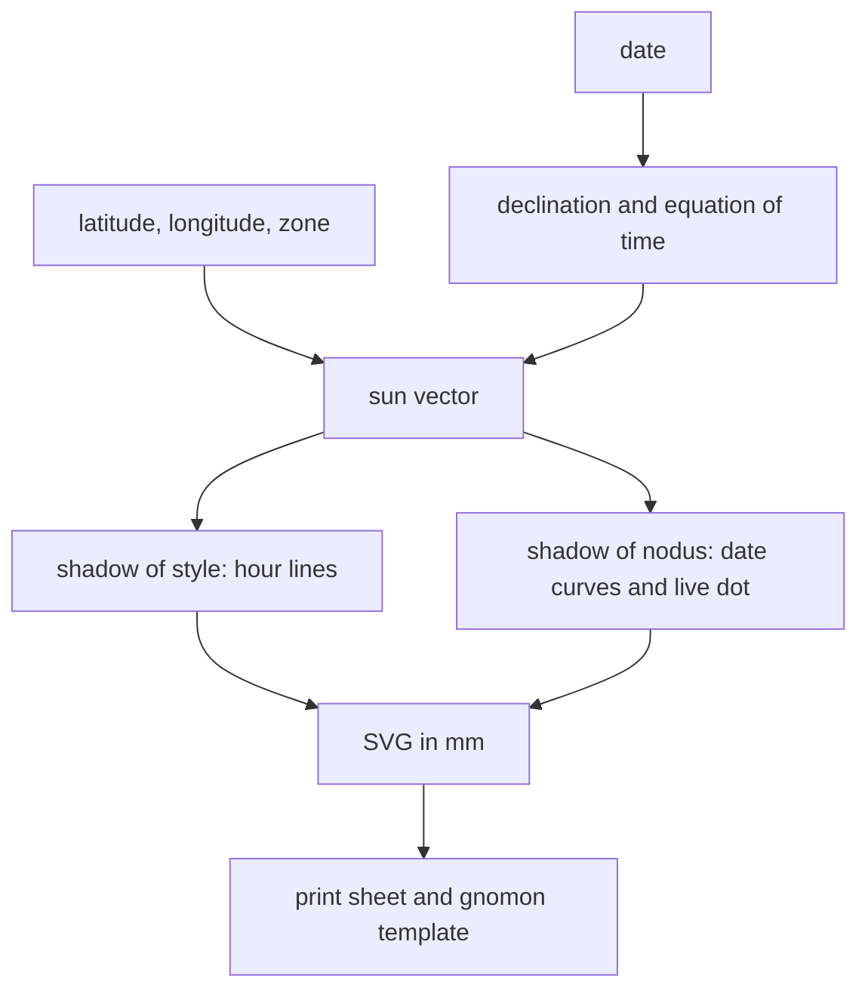

# Sundial Maker: How It Works

## Overview

Axes: x east, y north, z up. The sun direction comes from latitude, declination and hour angle. The style is a line through the origin parallel to the earth's axis. Its shadow on the plate is the hour line; a nodus point on it casts the date curves.

## Architecture

## File map

| File | Role |
|---|---|
| `src/dial.js` | Engine, no DOM |
| `index.html` | Inputs, SVG drawing, readouts |
| `test/test.js` | Anchors, laws, oracle comparison, mutants |
| `test/oracle.py` | Independent formulas, writes `oracle_cases.json` |
| `test/browser.js` | Headless Chromium checks |

## Core mechanisms

- Shadow of a point p under sun direction s on z = 0: p - (p_z / s_z) s.
- Hour line direction: s_z P - P_z s, which does not depend on declination (tested).
- Southern hemisphere: the style points at the south pole (P flips), so the dial mirrors with no special code.
- Standard-time mode shifts hour angles by (longitude - 15 x zone offset); the equation of time cannot be drawn, so it appears in the correction table.
- Gnomon: right triangle with the latitude at the foot; the nodus ring sits on the hypotenuse at height g.

## Data and formats

URL hash holds place and plate size. Everything else is computed. Oracle cases are a 440 KB JSON.

## Performance

Redrawing is instant (about 3,000 curve points). Tests run in about a second.

Related: [[Sundial Maker]] · [[Sundial Maker - Origin & Decisions]]
