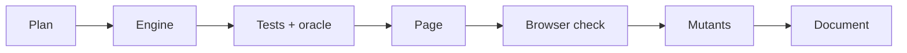

# Tile Shifter: Build Log

## Process

## Steps
1. Wrote `src/tile.js`: corner geometry, edge-local control points, partner-side construction, Catmull-Rom flattening, validity, shuffle, SVG and link codecs.
2. Wrote 11 Node tests with a winding-number coverage oracle.
3. Wrote the page (editor canvas, tiling canvas, controls) and a Playwright script.
4. Ran 11 mutants of the engine.
5. Read desktop and 375 px screenshots.

## Problems and fixes
| Problem | How it showed up | Change | Result |
|---|---|---|---|
| My "self-crossing" test tile was legal | Test 5 failed first run | Large bumps on one edge never cross because the twin is a translated copy; I used dots whose u runs backwards | Test passes for the right reason |
| Playwright import | `ERR_MODULE_NOT_FOUND` (ESM ignores NODE_PATH) | `createRequire` | Browser run works |
| One mutant "survived" | `partner not reversed` | Pattern did not exist in the file, so the mutant was never applied; the correctly written one was killed | Counted once, not twice |

## Verification
- `node --test`: 11 pass, 64 tiles, 9,600 points, 0 not covered exactly once.
- Mutants: killed partner not reversed, mirrored, wrong offset, wrong hex lattice, no self-intersection check, colour index, decoder accepts junk, smooth drops an end, wrong partner index. Survived: loosened area check (equivalent: for a simple outline with exactly matching seams the area is always one cell, so the check cannot fail).
- Browser: 12 shuffled tilings with zero fully transparent pixels; real mouse drag changed the tile; status read "Still a perfect tiling: area 2.598 equals one cell 2.598."; wild drag; share link reopened the same tile (rounded to 3 decimals); 5 samples while breathing; bad hash fell back; no horizontal overflow at 375 px; no console errors. Two screenshots read.

## Not verified
No human tried it. Other browsers, touch drag on a real phone, printing or cutting the SVG, and whether the shapes look good (I judged from two screenshots) are unchecked. The pixel-gap test only detects wholly transparent pixels, so a one-pixel overlap would not show; overlap is covered by the winding-number test instead.

Related: [[Tile Shifter]] · [[Tile Shifter - Origin & Decisions]] · [[Tile Shifter - Lessons & Observations]]
