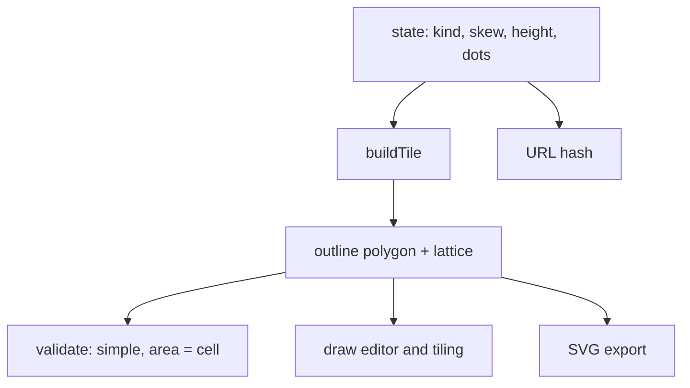

# Tile Shifter: How It Works

## Overview
A tile is a closed outline made of 4 (parallelogram) or 6 (hexagon) sides. Only the first half of the sides are independent; each remaining side is a translated, reversed copy of its partner.

## Architecture

## File map
| File | Role |
|---|---|
| builds/tile-shifter/src/tile.js | Engine, no DOM |
| builds/tile-shifter/index.html | Page, canvas drawing, pointer handling |
| builds/tile-shifter/test/tile.test.mjs | Engine tests and oracle |
| builds/tile-shifter/test/browser.mjs | Playwright run |

## Core mechanisms
- **Dots are edge-local.** A dot is (u, v): u along the edge, v sideways, both in edge lengths. Moving a corner-shape slider rescales the tile and keeps the dots.
- **Twin edge.** Side i+p equals side i shifted by `verts[i+p+1] - verts[i]` and traversed backwards, so seams match point for point.
- **Lattice.** Parallelogram: a and b. Hexagon with edges e0, e1, e2: e0+e1 and e1+e2. The area of the outline must equal their determinant.
- **Legality.** Crossing test on every segment pair (O(n²), about 100 points per outline) and the area check.
- **Colouring.** (i + 2j) mod 3, so every neighbour in a hexagon tiling differs.
- **Breathe.** A sine offset per dot per frame; illegal frames are skipped.

## Data and formats
Link string: `h|skew|height|u,v;u,v|...`, three decimals; the decoder rejects wrong counts, non-numbers and out-of-range values.

## Performance
Not measured beyond: the tests build 64 tiles and run 9,600 five-by-five-copy coverage checks in about 5 s of Node; the page redraws about 80 tiles per frame while breathing. I did not profile a phone.

Related: [[Tile Shifter]] · [[Tile Shifter - Origin & Decisions]]
