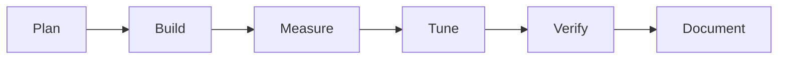

# Tonal Ladder: Build Log

## Process

## Steps

1. Checked tools: Node 22, Python 3.11, Playwright with Chromium.
2. Wrote `src/ladder.js`: OKLCH to linear sRGB, chroma fitting, hex output, luminance and contrast, ramp solver, gap finder, CSS export.
3. Printed one ramp by hand and saw targets matched (for example target 4.79 gave 4.77).
4. Wrote `test/oracle.py` and `test/run.js`; the first run passed.
5. Broke the code on purpose twice to check the tests can fail.
6. Wrote the page and `test/browser.js`; looked at a screenshot.

## Problems and fixes

| Problem | How it showed up | Change | Result |
|---|---|---|---|
| My browser test expected the wrong message | Test failed at "no pair reaches AAA" | The expectation was wrong: at 6 steps and 8:1, AAA is 5 steps apart. I changed the test to the true value and added matrix cell checks | 9 of 9 pass |

The core had no failures to fix, so the oracle test has not yet caught a real bug of mine. Only the planted ones.

## Verification

- `node test/run.js`: 108 ramps, 664 passed, 0 failed. Worst pair error 1.15%, worst hue drift 3.18°, max chroma overshoot 0.0016.
- Mutation 1 (luminance offset changed): worst pair error 47%, 217 failed. Mutation 2 (hue shifted 0.2 rad): 92 failed, worst hue drift 13.75°.
- `node test/browser.js`: 9 passed in headless Chromium, screenshot inspected.

## Not verified

- Only Chromium, one viewport (1000 px); no phone layout, Firefox or Safari.
- The 4% pair tolerance and 4° hue tolerance were chosen by me before seeing results; they are loose, and 8-bit rounding makes tighter limits impossible near white.
- Contrast values were checked against my own formula in Python and two reference numbers I remember (21 and about 4.48), not against a third-party checker.
- The pair-guarantee test is run on the test's own ramps, not every UI setting.
- No designer used it.

Related: [[Tonal Ladder]] · [[Tonal Ladder - Origin & Decisions]] · [[Tonal Ladder - Lessons & Observations]]
