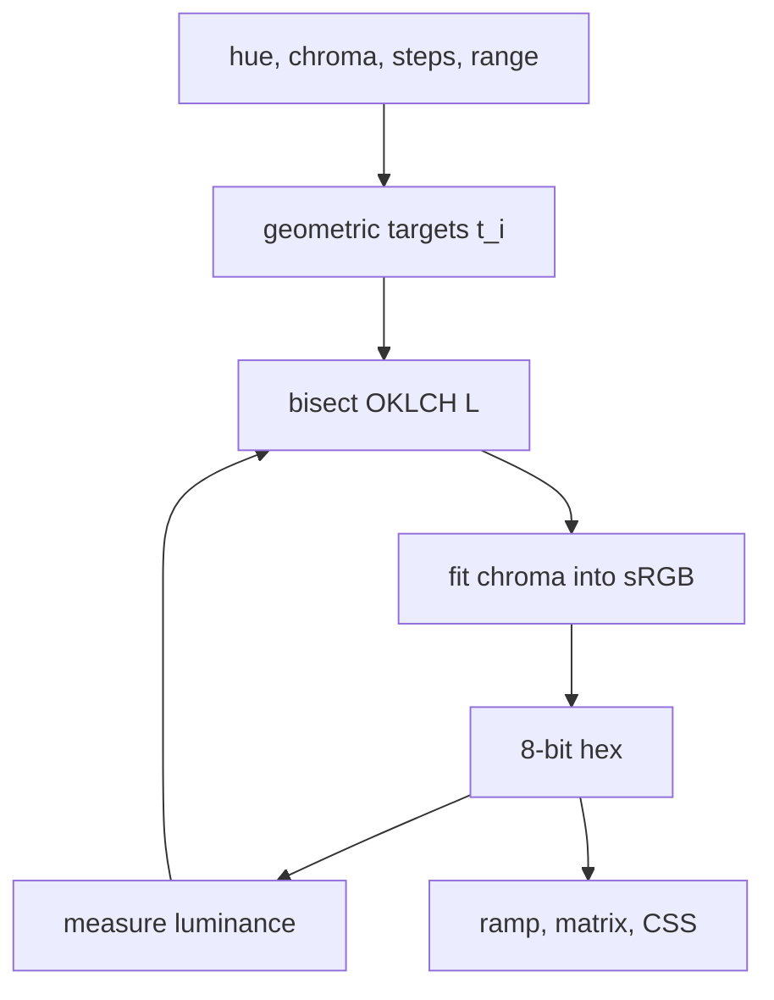

# Tonal Ladder: How It Works

## Overview

For a target contrast `t` against white, the needed luminance is `Y = 1.05/t - 0.05`. The solver finds the OKLCH colour with the requested hue and (at most) the requested chroma that has that luminance.

## Architecture

## File map

| File | Role |
|---|---|
| `src/ladder.js` | All logic; works in Node and the browser |
| `index.html` | Controls, ramp, matrix, demo, CSS export |
| `test/run.js` | Reference values, validation, 108-ramp sweep, gap checks |
| `test/oracle.py` | Independent re-derivation from hex strings |
| `test/browser.js` | Headless Chromium checks and screenshot |

## Core mechanisms

- Pair property: `contrast(a,b) = cw(a)/cw(b)`, so geometric `cw` with ratio r gives `r^k` for steps k apart. `gapFor` returns the smallest k with `r^k` at or above 3, 4.5 or 7.
- Chroma fit: bisection (24 iterations) on chroma until the colour is in sRGB. Lightness bisection runs 40 iterations on the quantised hex luminance, then picks the better of the two neighbouring 8-bit results.

## Data and formats

Ramp is `{hue, ratio, steps:[{index, hex, L, chroma, target, vsWhite, vsBlack}]}`. CSS output is `--tone-N: #rrggbb`.

## Performance

A 10-step ramp solves in well under a frame; the 108-ramp test plus oracle runs in about a second. No profiling was done.

Related: [[Tonal Ladder]] · [[Tonal Ladder - Origin & Decisions]]
