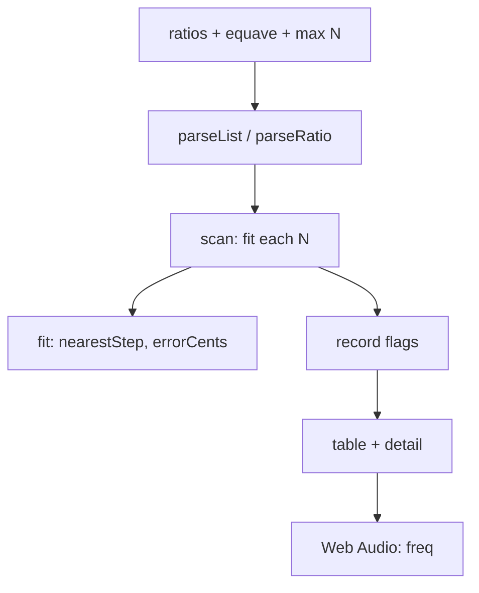

# Tuning Fit: How It Works

## Overview
Pure functions in one file, a thin page on top.

## Architecture

## File map

| File | Role |
|---|---|
| `src/edo.js` | Engine; works in browser (`window.TuningFit`) and Node |
| `index.html` | Inputs, tables, audio, permalink in `#hash` |
| `test/test.js` | Engine checks and oracle sweep |
| `test/oracle.py` | Exact integer/Decimal oracle |
| `test/browser.js` | Headless Chromium driver |

## Core mechanisms
- A ratio is a reduced fraction of integers (up to 1,000,000). Decimals like 1.25 become fractions.
- For N steps of equave E, ratio r sits at x = N*log(r)/log(E) steps. The nearest step is floor(x), plus one if the fractional part is above 0.5 (within 1e-9 counts as a tie, going up).
- Error is `k*cents(E)/N - cents(r)`, so positive means the tempered interval is wider than pure.
- RMS is the root mean square of errors; "worst" is the largest absolute error.
- Record: score below every smaller N's best (strictly, with a 1e-12 margin).
- Play: base and pure note together, then base and `freq(base, k, N, E)`, as sine waves with short ramps.

## Data and formats
State is a small JSON in the URL hash (ratios, equave, max N, metric, selected N). A bad hash falls back to defaults.

## Performance
Scanning up to 400 sizes for 24 ratios is about 10,000 cheap computations, instant on every keystroke. Not profiled in detail.

Related: [[Tuning Fit]] · [[Tuning Fit - Origin & Decisions]]
