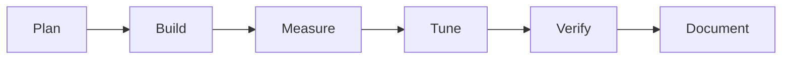

# <Project>: Build Log

## Process

## Steps

1. 

## Problems and fixes

| Problem | How it showed up | Change | Result |
|---|---|---|---|

## Verification

What was tested, how, and the actual output.

## Not verified

What nobody checked, and what could still be wrong.

Related: [[<Project>]] · [[<Project> - Origin & Decisions]] · [[<Project> - Lessons & Observations]]
