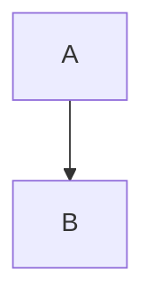

# <Project>: How It Works

## Overview

## Architecture

## File map

| File | Role |
|---|---|

## Core mechanisms

## Data and formats

## Performance

Related: [[<Project>]] · [[<Project> - Origin & Decisions]]
